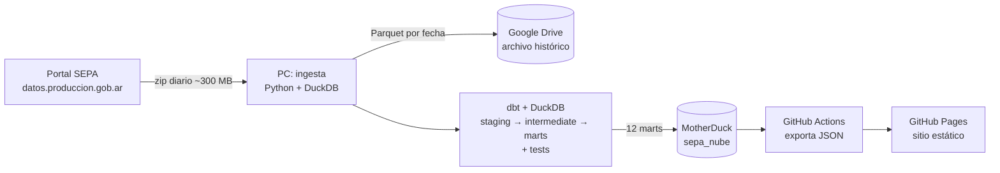

# Precios de supermercados de Argentina (SEPA)

Pipeline de datos que todos los días baja los precios que las cadenas de supermercados informan al Estado (unos 14 millones por día), los modela con dbt y publica un sitio estático para seguir el precio de cualquier producto en cada cadena y provincia.

**Sitio:** https://neog14.github.io/sepa-pipeline/

## Qué muestra el sitio

- **Cuánto cambiaron los precios** de cada cadena desde el primer día, con un índice encadenado que compara miles de productos día contra día.
- **Qué cadena conviene según lo que comprás**: un ranking por tipo de producto (almacén, limpieza, lácteos…) en cada provincia.
- **Precio por kilo** de carnes, quesos, frutas y verduras, que no tienen código de barras común entre cadenas.
- **Buscador**: el precio de hoy de cada producto en cada cadena y cómo cambió desde que se empezó a guardar.

## Arquitectura



Cada día a las 14:30, el Programador de tareas de Windows corre `python -m ingesta.main`:

1. Consulta el catálogo del portal y baja las fechas que falten (el archivo es un zip con un zip por cadena).
2. Valida y guarda el día como Parquet, y lo copia a Drive como archivo histórico.
3. Corre `dbt build`: actualiza los modelos y ejecuta los tests.
4. Sube los marts a MotherDuck y comprueba que en la nube haya las mismas filas que en la PC.
5. Dispara el workflow de GitHub Actions, que lee MotherDuck, arma los JSON y publica el sitio en GitHub Pages.

La página nunca consulta una base de datos: son archivos estáticos, sin credenciales ni costo por visita.

### Por qué la ingesta corre en una PC

El portal de datos responde `403` a las descargas desde GitHub Actions y desde Google Colab, y `200` desde una conexión hogareña. La ingesta corre en la PC y la nube recibe solo datos ya procesados. BigQuery se descartó porque pedía un prepago: dbt corre sobre DuckDB local y los marts viven en el plan gratuito de MotherDuck.

## Los datos en números

Medido el 24/10/2026, con 15 días de historia.

| Paso | Filas |
|---|---|
| Precios crudos del día (una fila por sucursal y producto, 7 cadenas, ~2.500 sucursales) | 14.051.448 |
| Con precio de lista válido, en sucursales físicas con provincia | 13.928.410 |
| Agregados: mediana por cadena, producto y provincia | 1.371.418 |
| Con código de barras (comparables entre cadenas) | 1.330.089 |
| Representativos (informados en al menos el 5 % de las sucursales de la cadena) | 1.279.592 |
| Usados en el índice de precios de ese día | 1.275.687 |

- Catálogo: 72.875 productos.
- Historial de cambios de precio: 2.088.374 filas. Se guarda una fila solo cuando el precio cambia, no una foto diaria.
- Se conservan las 7 cadenas que suman el 99 % de las filas: La Anónima, Cencosud, Carrefour, Changomas, Coto, Cooperativa Obrera y DIA.

## Modelado con dbt

- **staging**: vistas sobre los Parquet, con la clave de producto comparable entre cadenas (código de barras sin ceros) y las marcas normalizadas.
- **intermediate**: el agregado diario por cadena, producto y provincia (ventana de 21 días), la cobertura de sucursales y la clasificación de productos.
- **marts**:
  - `fct_precios_cambios`: historial de precios como SCD tipo 2, incremental y protegido contra `--full-refresh`.
  - `fct_canasta_provincia`: ranking diario de cadenas por provincia (media geométrica del precio contra la mediana del producto).
  - `fct_canasta_provincia_grupo`: el mismo ranking por tipo de producto.
  - `fct_indice_cadena`: índice encadenado día contra día por cadena y provincia.
  - `fct_precio_kilo_provincia`: precio por kilo de los productos que se venden al peso.
  - `fct_cobertura`: sucursales que informaron cada día contra las habituales, para no confundir un cambio de muestra con un cambio de precio.
- **tests**: más de 70, entre genéricos (unique, not_null, accepted_values, relationships) y propios en SQL (que el historial reconstruya el agregado, coherencia de los rankings y del índice, volumen por cadena).

El detalle de cada tabla y columna está en el [diccionario de datos](docs/diccionario_de_datos.md).

## Clasificación de productos

Para comparar por tipo de producto, cada uno de los 72.875 productos se clasifica en uno de 85 rubros:

1. Una muestra de 600 productos etiquetada a mano (`etiquetado/`, `scripts/elegir_muestra_etiquetado.py`).
2. Reglas por nombre (`scripts/rubros.py`) y un modelo de texto con scikit-learn (`scripts/entrenar_modelo.py`), evaluados en 300 productos de prueba que el modelo no vio.
3. Un LLM (DeepSeek) sobre el mismo conjunto de prueba: 91,6 % de acierto con 99,7 % de cobertura, contra 86,4 % y 85,7 % de reglas más modelo. Todo el uso de DeepSeek en el proyecto costó alrededor de US$ 1,20.
4. En dbt (`clasificacion_productos`) gana la corrección manual, después DeepSeek, y para los productos nuevos que todavía no pasaron por DeepSeek, las reglas y el modelo. Así la corrida diaria no depende de una API externa.

## Decisiones y limitaciones

- **Precio de lista.** Las promociones se informan pero no se usan para comparar.
- **Mediana entre sucursales.** El precio de una cadena en una provincia es la mediana de sus sucursales. Un producto informado por menos del 5 % de las sucursales no entra en la comparación (evita remates en pocas sucursales).
- **Cobertura.** Algunas cadenas informan menos sucursales ciertos días (la Cooperativa Obrera, los domingos). Esos días se marcan, y los saltos de un día que vuelven al precio anterior no se publican.
- **Productos frescos.** Carnes, frutas y verduras no comparten código de barras entre cadenas. Se comparan por precio por kilo, con una lista de códigos por cadena clasificada aparte. No todas las cadenas informan todos los frescos.
- **Historia corta.** Los datos arrancan en octubre de 2026 y el portal pisa cada archivo a la semana: lo que no se baja en 7 días se pierde.

## Cómo correrlo

Requisitos: Python 3.12 y las variables de entorno de abajo.

```powershell
conda create -n sepa python=3.12
conda activate sepa
pip install -r requirements.txt

$env:SEPA_DATOS_DIR = "C:\ruta\a\sepa-datos"   # Parquet, base DuckDB y logs
$env:SEPA_DRIVE_DIR = "G:\Mi unidad\sepa-pipeline"   # copia de los Parquet en Drive

python -m ingesta.main                     # baja lo pendiente, Parquet, dbt build y subida a MotherDuck
python -m publicar.exportar_json --local   # arma los JSON del sitio desde la base local
python -m http.server 8000 -d sitio        # el sitio en http://localhost:8000
```

Variables con secretos, nunca en el código:

- `motherduck_token`: para subir los marts y para exportar desde MotherDuck. En GitHub Actions es un secret del repo.
- `DEEPSEEK_API_KEY`: solo para los scripts que clasifican con el LLM.

El modelo de clasificación entrenado y la muestra etiquetada no están en el repo: viven en la carpeta de datos.

## Estructura

```
ingesta/      descarga, validación y Parquet (corre en la PC)
models/       dbt: staging, intermediate y marts
macros/       macros de dbt (clave de producto, limpieza de descripción y marca, fechas a procesar, pares del índice)
tests/        tests de dbt en SQL
seeds/        tablas chicas: cadenas, rubros, clasificación de DeepSeek, pesables, recetas
publicar/     subida a MotherDuck y exportación de los JSON del sitio
scripts/      clasificación de productos, mediciones citadas en los modelos y verificaciones
sitio/        el sitio estático: HTML, CSS y JavaScript con Chart.js
etiquetado/   herramienta para etiquetar a mano la muestra
docs/         diccionario de datos
```

## Fuente

Precios: [SEPA, Sistema Electrónico de Publicidad de Precios Argentinos](https://datos.produccion.gob.ar/dataset/sepa-precios), Secretaría de Comercio.
